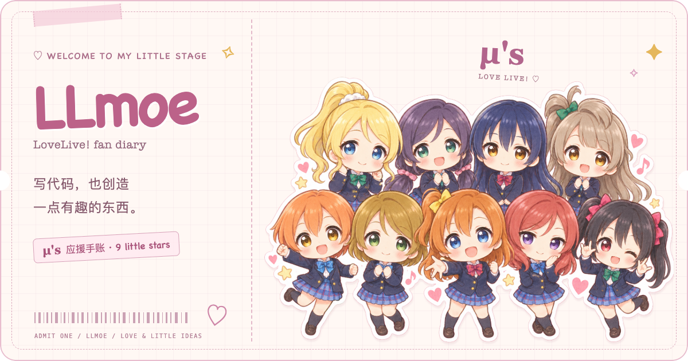
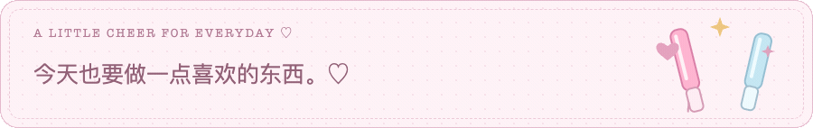
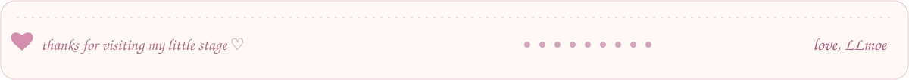

  <picture>
    <source media="(max-width: 600px)" srcset="./assets/hero-lovelive-v3-mobile.png" />
    
  </picture>

  <strong>写代码，也创造一点有趣的东西。</strong> 
  LoveLive! · μ's · code & little daydreams ♡

  <picture>
    <source media="(max-width: 600px) and (prefers-reduced-motion: reduce)" srcset="./assets/cheer-lovelive-v3-mobile.png" />
    <source media="(max-width: 600px)" srcset="./assets/cheer-lovelive-v3-mobile.gif" />
    <source media="(prefers-reduced-motion: reduce)" srcset="./assets/cheer-lovelive-v3.png" />
    
  </picture>

  <strong>🎀 一点点关于我</strong>  
  喜欢 μ's，也喜欢可爱的小东西。 
  写一点代码，收集一点灵感，把喜欢的小想法慢慢做出来。 
  欢迎来到我的小小舞台 ♡

 

  

