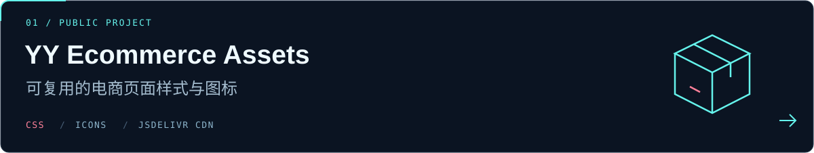

  <picture>
    <source media="(max-width: 600px)" srcset="./assets/hero-mobile.png" />
    
  </picture>

  <strong>写代码，也创造一点有趣的东西。</strong> 
  A little code. A little curiosity. A world of possibilities.

  <a href="https://github.com/llmoe?tab=repositories">浏览仓库 ↗</a>
  &nbsp; · &nbsp;
  <a href="https://github.com/llmoe?tab=stars">我的收藏 ↗</a>

  <picture>
    <source media="(prefers-reduced-motion: reduce)" srcset="./assets/terminal.png" />
    
  </picture>

### ✦ 关于我 · About me

喜欢让想法变成可以使用的小东西，也喜欢把界面做得好看一点。

在这里，分享一些代码、实用资源，以及探索过程中的小发现。欢迎逛逛我的仓库，也欢迎交流。

### ◈ 公开项目 · Featured project

[**yy-ecommerce-assets ↗**](https://github.com/llmoe/yy-ecommerce-assets) · 电商页面公共静态资源，整理可复用的 CSS 和图标，并通过 jsDelivr CDN 分发。

### ⌘ 收藏与探索 · Forks & experiments

| 仓库 | 做什么 |
| :--- | :--- |
| [proxy-provider-converter ↗](https://github.com/llmoe/proxy-provider-converter) | Clash 订阅转换工具 · Fork 自 [qier222](https://github.com/qier222/proxy-provider-converter) |

 

  

