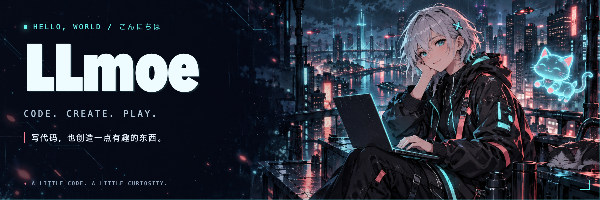
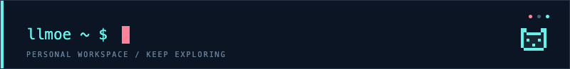
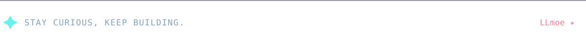

  <picture>
    <source media="(max-width: 600px)" srcset="./assets/hero-mobile.png" />
    
  </picture>

  <strong>写代码，也创造一点有趣的东西。</strong> 
  A little code. A little curiosity. A world of possibilities.

  <picture>
    <source media="(prefers-reduced-motion: reduce)" srcset="./assets/terminal.png" />
    
  </picture>

### ✦ 关于我 · About me

喜欢让想法变成可以使用的小东西，也喜欢把界面做得好看一点。

保持好奇，记录灵感，慢慢把有趣的想法变成现实。欢迎交流。

 

  

